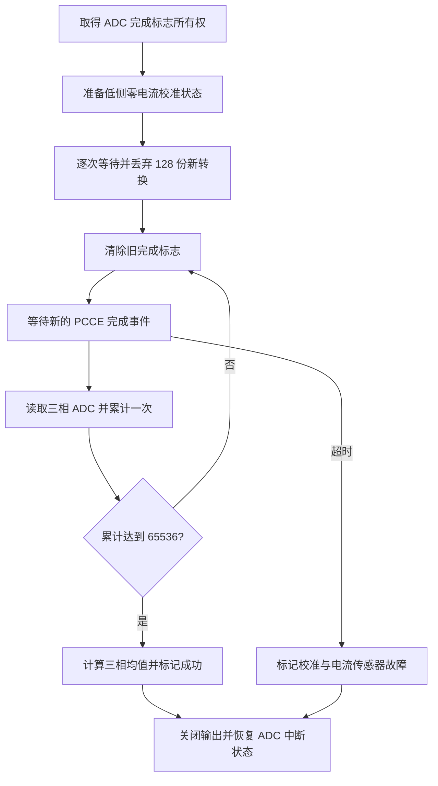

# S03：电流零偏校准新样本同步修复

## 结论

已修复原校准循环反复读取同一份 ADC 数据、却把读取次数当作新采样次数的问题。实际代码位置为本地：

`D:\workspaces\code-registories\FOC\FOC_Driver_V2\motor_controller`

本次保持现有启动阻塞校准接口和 65536 次平均设置：每次累计必须等待新的 ADC2 抢占序列完成事件。新增 ADC 标志独占管理、128 份稳定样本丢弃、超时退出、故障锁存，以及初始化失败后的对齐／电流环启动阻断。没有烧录或驱动电机。

## 1. 原问题与影响

原流程：

```c
while (!m->current_offset_cal_done) {
    board_get_phase_current(m);
    current_sense_process_sample(m);
}
```

`board_get_phase_current()` 只读取数据寄存器，不代表 ADC 刚完成一次新转换。软件循环可以在两次硬件采样之间读取多次相同寄存器内容。

因此 `offset_cnt == 65536` 原来只证明软件调用了 65536 次，不能证明获得了 65536 份新样本。启动阶段遗留值、驱动器唤醒瞬态和部分噪声可能被重复加权，平均次数也不能反映真实平均效果。

零偏用于电流换算：

\[
I_k=(ADC_k-Offset_k)\frac{V_{ref}}{4095}K_{sense}K_{polarity}
\]

零偏误差直接形成相电流误差，进而进入 Clarke/Park 变换，影响 Id/Iq 反馈、电流 PI、转矩平稳性及软件电流保护。三相均值扣除只能去除共模分量，不能保证去掉每相不同的零偏误差。

这里“新样本”指不同硬件转换产生的数据，并不等同于统计学上的完全独立噪声样本。

## 2. 为什么选择启动阶段独占轮询

当前初始化顺序：

```text
外设初始化，ADC 定时触发已经运行
  → motor_hw_init()
  → foc_init()
      → current_sense_init()：阻塞校准
      → 可选电角对齐
  → mc_runtime_start()：注册正常电流环回调
```

因此不能直接让阻塞校准等待尚未注册的正常电流环回调累计。另一方面，Workbench 已启用 ADC2 完成中断，直接轮询完成标志可能被中断处理程序抢先清除。

本次通过 Board 接口临时取得完成标志所有权：仅禁止 ADC2 抢占序列完成中断，**不停止 ADC 转换、不停止 PWM 定时器和触发链**。校准结束后恢复原来的中断使能状态。

这是一项启动路径修复，不是运行中非阻塞重校准方案；不能在正常运动期间随意调用。

## 3. 修改后的时序



### 3.1 Board 接口

新增 `current_hw_calibration_begin()`、`current_hw_calibration_read()`、`current_hw_calibration_end()`。

- `begin`：拒绝从 ISR 调用，保存 ADC2 PCCE 中断使能并关闭它，清除旧事件。
- `read`：清除旧完成标志，等待新的完整抢占序列；读取三相数据并清标志。寄存器快照区保存／恢复 CPU 中断屏蔽状态，避免普通 ISR 打断三相读取。
- `end`：清理残留事件，恢复原 ADC 中断状态。恢复前先关闭电机输出。

没有将 ADC 物理通道、转换排序、PWM 最大占空比或正常电流环频率改掉。没有使用虚假的软件序号代替真实硬件转换完成事件。

### 3.2 稳定时间与平均

默认丢弃 `CURRENT_OFFSET_SETTLING_SAMPLES = 128` 份新转换，让唤醒及低侧准备后的早期数据不进入均值。可通过工程宏配置；模拟链路是否已经充分稳定仍须实测。

当前 20 kHz 条件下，理论平均时间：

\[
T_{average}=65536/20000=3.2768\;s
\]

加上 128 次丢弃约 6.4 ms，总计约 **3.2832 s**，另有软件执行及可能丢弃额外事件的时间。并不保证接收每一次转换，只保证每次计数前等待新完成事件。

三相累加和采用现有 `uint32_t`：最大值 `4095 × 65536 = 268369920`，不会溢出。均值仍通过右移 16 位获得。

### 3.3 超时与失败清理

每次等待最多按 TMR6 微秒时基等待 1000 μs；16 位模减法处理其 65.536 ms 回绕。另有 1000000 次轮询上限，避免时基和 ADC 同时停止时永久卡在等待循环。后者是有限迭代保护，不是准确的 1 ms 时间保证。

采样失败时：

- 关闭电机输出。
- 清除 pending、calibrating 和运行时 active 状态，保持 done=false。
- 锁存 `FAULT_CURRENT_SENSOR | FAULT_CALIBRATION`。
- 恢复原 ADC PCCE 中断使能。
- `foc_init()` 不再执行后续电角对齐。
- `mc_init()` 返回 `ERR_OFFSET_CAL`，不注册并启动正常电流环。

当前 `main()` 对初始化失败进入既有错误等待分支；该分支尚没有完善的错误上报，本次不扩展通信启动结构。

## 4. 正常采样与校准累计分离

`current_sense_process_sample()` 保留正常 ADC→物理电流换算，但不再顺带累计零偏。只有启动校准路径在新事件读取成功后显式调用累计步骤。

因此重复调用物理量处理函数、或只设置 pending 标志，不能再误把旧寄存器值当作新的零偏样本。若未来需要运行中重新校准，应新增明确的停机、所有权交接和状态机接口。

## 5. 平台处理

AT32 实现基于当前项目的 ADC2 PCCE、定时器触发和 TMR6 时基。

STM32/GD32 端口当前没有经过验证的新样本轮询实现，本次新增对应接口并明确返回 `ERR_NOT_IMPL`，随后校准按失败路径退出，避免继续报告虚假成功。**这意味着这些端口需要完成 Board 适配后才能通过当前初始化。** 本次完整目标构建及实际功能范围为 AT32M416，不能宣称已完成 STM32/GD32 的硬件移植。

## 6. 文件与验证

修改文件：

- `project/APP/FOC/current_sense.c/.h`：稳定样本、新完成事件累计、失败清理；正常处理不再累计。
- `project/Board/board.h`、`board_at32.c`：新增校准期 ADC 所有权及超时轮询接口。
- `project/Board/board_stm32.c`、`board_gd32.c`：未适配端口明确失败。
- `project/APP/FOC/foc.c`、`project/APP/mc_interface.c`：失败后阻断对齐及运行启动。

新增主机测试：`tests/run_offset_calibration_tests.py`，Windows 下使用 MSVC C 工具。运行：

```powershell
python tests/run_offset_calibration_tests.py
```

通过的验证包括：

1. 真实 `current_sense.c`：128 次丢弃后，必须累计 65536 次成功新样本读取，三相均值准确。
2. 重复调用正常数据处理 1000 次，不增加校准累计数。
3. 稳定期失败、累计中途失败、无法取得 ADC 所有权时，不误报成功且关闭输出。
4. 从真实 `board_at32.c` 提取轮询函数进行硬件桩测试：旧标志丢弃、新事件读取、IRQ 状态恢复、微秒时基回绕、ADC 停转、时基停转及 ISR 调用拒绝。
5. 初始化路径检查：失败分支位于电角对齐和电流环注册之前。
6. ARMCC 5.06u7：本地 MDK 工程 58 个目标文件完整编译链接通过。输出在独立分析目录，未覆盖用户已有修改的 `motor_controller.hex`。

主机桩不能证明真实模拟信号已稳定，也不能替代上板测试。此次没有烧录或带电运行。

## 7. 对控制的影响与上板验收

正常运行中没有新增轮询开销；变化集中在启动校准。启动时间变长，但零偏平均建立在真实新转换上，反馈和保护的基础更可信。它不改变电流环 PI 参数、调制电压上限或电机额定转矩。

上板应确认：

- 断电静止电机或确保真实相电流接近零；低侧制动不代表转动电机没有电流。
- 校准计数随新 ADC 转换增加，时间在约 3.28 s 量级；预期三相零偏应接近硬件偏置对应 ADC 值。
- 示波器确认驱动器唤醒、低侧状态及电流输出已在丢弃阶段内稳定。
- 核对快照读取远短于采样间隔；CPU 屏蔽普通中断不停止 ADC，启动期若存在超长中断延迟仍须检查序列读取时序。
- 停止 ADC 触发后应有限时间退出，done=false、故障锁存，输出关闭且不继续电角对齐。
- 恢复正常触发后重新上电验证成功路径与正常 FOC 电流波形。

65536 个新样本解决的是重复计数问题，不替代电机静止条件、偏置范围检查、噪声方差检查和传感器连通性诊断；这些属于后续校准质量增强项。
