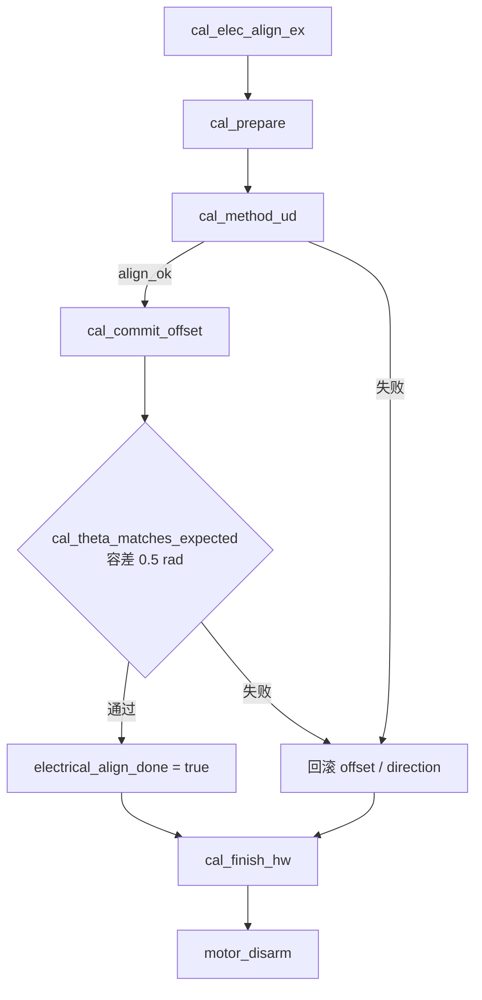

# Ud 单点电角对齐流程分析（`cal_method_ud`）

> 项目：`motor_controller/project`  
> 源码：`project/APP/FOC/foc_calibration.c`  
> 方案枚举：`CAL_ELEC_ALIGN_UD = 0`（默认，`CAL_ELEC_ALIGN_METHOD_DEFAULT`）  
> CAN：主机发 `0xAB`，DATA[0]=`0`（Ud）；应答 14 B，见 [CAN-FD通信协议.md](./CAN-FD通信协议.md)「0xAB 电角度对齐应答」  
> 关联排查记录：[电角对齐问题排查与修复记录.md](./电角对齐问题排查与修复记录.md)

---

## 1. 在总流程中的位置

对外入口：

```
cal_elec_align_ex()
  └─ cal_elec_align_run()
       ├─ cal_prepare()          // 清零 offset、上电、开环准备
       ├─ cal_method_ud()        // 本文主体
       ├─ cal_commit_offset()    // align_ok 时写入 RAM
       ├─ cal_theta_matches_expected()  // 提交后验收
       ├─ cal_finish_hw()        // 泄压、清 PI
       └─ motor_disarm()         // 失败时回滚 offset/direction
```



**说明：** 对齐成功只更新 RAM 中的 `theta_elec_offset_rad` 与 `direction`；持久化需另发参数保存命令（如 `0x3A`）。失败路径会恢复对齐前的 offset 与 direction。

---

## 2. 坐标与符号约定

| 符号 | 含义 | 代码 / 配置 |
|------|------|-------------|
| `θ_open` | 对齐时开环 Park **电角** | `ctx->align_angle` ← `cfg.align_angle_rad`，默认 `ALIGN_ELECTRICAL_ANGLE_RAD` = **3π/2（270°）** |
| raw 电角 | 编码器观测量 × 极对数，**未减 offset** | `cal_encoder_raw_elec_rad()` ≈ `shaft.angle_rad × pole_pairs`（`direction` 已在 `angle_rad` 中） |
| 运行电角 | 电流环 / Park 使用 | `theta_elec_rad = normalize(angle_rad × pp − theta_elec_offset_rad)`（`encoder.c`） |
| Ud 锁定 | `Ud = voltage_d_v`，`Uq = 0` | 默认 `ALIGN_ELECTRICAL_VOLTAGE_D_V` = 5.0 V |

### 2.1 Ud 方案的 offset 定义

锁定在 `θ_open` 下采样 `raw_locked`，则：

```
offset     = normalize(raw_locked − θ_open)
theta_elec = normalize(raw_locked − offset) = θ_open   // 理想锁定瞬间
```

与 **Uq 单点（dex-con）** 的 `offset = raw`、对齐后 `theta_elec ≈ 0` **不是同一零位定义**，数值不可直接对比。

### 2.2 对齐过程中的 offset

`cal_prepare()` 将 `theta_elec_offset_rad = 0`，因此 sweep / 采样阶段 `theta_elec` 等于 raw 电角，便于用 raw 计算 offset。

---

## 3. 默认配置参数（`common.h` / `cal_elec_align_cfg_default`）

| 参数 | 宏 / 字段 | 典型值 | 用途 |
|------|-----------|--------|------|
| 开环电角 | `align_angle_rad` | 270° | `θ_open` |
| d 轴锁定电压 | `voltage_d_v` | 5.0 V | Ud sweep / lock |
| 锁角保持 | `hold_ms` | 700 ms | `cal_lock_sample` |
| 采样次数 | `sample_count` | 16 | raw 均值与 spread |
| 采样间隔 | `sample_interval_ms` | 5 ms | hold 与 sample 步进 |
| spread 上限 | `rotor_spread_max_rad` | 0.09 rad | 锁角稳定性 |
| 跟场容差 | `rotor_engage_tol_rad` | 0.35 rad | +90° 与回零检验 |
| 极对数 | `pole_pairs` | 电机参数 | 扫一圈电角期望机械行程 |

---

## 4. 子过程说明

### 4.1 `cal_prepare`

- 保存当前 `theta_elec_offset_rad`、`direction`（失败回滚用）。
- **`theta_elec_offset_rad = 0`**，清空对齐结果标志。
- `cal_setup_lock_axes`：Ud 下 `lock_ud = voltage_d_v`，`lock_uq = 0`。
- `foc_sense_update` → 记录 `align_theta_before_rad`。
- **`motor_arm` + PWM 使能**；全程使用 `foc_voltage` 开环，不走电流环。

### 4.2 `cal_lock_sample`

每次调用（Ud 流程共 **4 次**）：

1. **`cal_hold_voltage`**：在指定电角 `angle_el` 下，用 `lock_ud/lock_uq` 持续 **`hold_ms`**。
2. **`cal_sample_raw_at_lock`**：同角度下采 **`sample_count`** 次 raw，得 **`ctx->raw_locked`** 与 **spread**（采样极差）。
3. spread > **`rotor_spread_max_rad`** → `ERR_ALIGIN_SPREAD_OUT`（约 error 11）并置对齐故障。

单次耗时量级：约 **700 ms + 16×5 ms ≈ 780 ms**。

### 4.3 `cal_ud_sweep(start, end)`

- 开环 **电角** 从 `start` 线性插值到 `end`，**360 步**；每步 `cal_hold_voltage(..., sample_interval_ms)`（5 ms）。
- 终点再 **`hold_ms`（700 ms）** 稳定。
- 累加 **机械轴** `shaft.angle_rad` 的 unwrap 增量，返回 **`travel`（rad，可正可负）**。
- 电压：`Ud = voltage_d_v`，`Uq = 0`。

**物理关系：** 磁场旋转 **一整圈电角（2π rad）** 时，转子应转机械角：

```
expected = 2π / pole_pairs
```

注释约定：**方向仅由转子实际运动判定，不用电流极性探针**（与 Dual / HFI 不同）。

单次完整 **2π 电角** sweep 耗时约：**360×5 ms + 700 ms ≈ 2.5 s**。

---

## 5. `cal_method_ud` 逐步流程

源码：`foc_calibration.c` → `cal_method_ud()`。

```mermaid
flowchart TD
  S0[设置 lock_ud / lock_uq=0] --> S1[① cal_lock_sample @ θ_open]
  S1 --> S2[② forward sweep θ_open → θ_open+2π]
  S2 --> S3[③ reverse sweep 回到 θ_open]
  S3 --> S4{④ 行程校验 ±15%}
  S4 -->|失败| FAIL[ERR_ALIGIN_FAILED]
  S4 --> S5{⑤ forward < 0 ?}
  S5 -->|是| FLIP[cal_flip_direction]
  S5 --> S6[⑥ lock @ θ_open → base]
  FLIP --> S6
  S6 --> S7[⑦ sweep +π/2 电角]
  S7 --> S8[⑧ lock @ θ_open+π/2 → probe]
  S8 --> S9{⑨ |probe−base−π/2| ≤ tol}
  S9 -->|失败| FAIL
  S9 --> S10[⑩ sweep 回 θ_open]
  S10 --> S11[⑪ lock @ θ_open]
  S11 --> S12{⑫ |raw−base| ≤ tol}
  S12 -->|失败| FAIL
  S12 --> S13[⑬ offset = raw − θ_open]
  S13 --> OK[align_ok = true]
```

### 阶段 A：极对数 + 编码器 direction（步骤 ①～⑤）

| 步骤 | 动作 | 目的 |
|------|------|------|
| ① | `cal_lock_sample(θ_open)` | 确认能吸合，spread 合格 |
| ② | 电角 `θ_open → θ_open + 2π` | 正向拖一整圈电角，记机械行程 `forward` |
| ③ | 电角扫回 `θ_open` | 记 `reverse` |
| ④ | `forward × reverse < 0`，且 `\|forward\|`、`\|reverse\|` 均在 **expected ±15%** | 排除极对数错误、跟场失败、打滑 |
| ⑤ | 若 `forward < 0` → **`cal_flip_direction`** | 使配置 `direction` 与「场转 +2π 电角时转子正转」一致；`align_direction_flipped = true` |

**不调用** `cal_polarity_correct()`；**无 Iq 极性探针**。

### 阶段 B：跟场 / 吸合验证（步骤 ⑥～⑫）

| 步骤 | 动作 | 目的 |
|------|------|------|
| ⑥ | 回到 `θ_open` 锁角 | `base = raw_locked` |
| ⑦ | 开环拖到 **`θ_open + π/2`（+90° 电角）** | 非对极点，验证转子跟场 |
| ⑧ | 在新电角锁角采样 | `probe = raw_locked` |
| ⑨ | `\|probe − base − π/2\| ≤ rotor_engage_tol_rad` | raw 应随场约 +90° |
| ⑩ | 扫回 `θ_open` | |
| ⑪ | 再次在 `θ_open` 锁角 | |
| ⑫ | `\|raw − base\| ≤ tol` | 回零重复性 |

### 阶段 C：写结果（步骤 ⑬）

```c
ctx->offset_rad = angle_normalize(ctx->raw_locked - ctx->align_angle);
ctx->rt->align_raw_elec_rad = ctx->raw_locked;
ctx->rt->align_raw_engage_rad = probe;   // 步骤 ⑧ 的 raw
ctx->rt->align_engaged = true;
ctx->rt->align_polarity_test_iq = 0.0f;   // Ud 不做探针
ctx->rt->align_ok = true;
```

---

## 6. 提交与事后校验

### 6.1 `cal_commit_offset`

- 写入 `m->config.param.theta_elec_offset_rad = ctx->offset_rad`。
- `foc_sense_update()` → 更新 `align_theta_after_rad`、`open_loop_elec_angle_rad`。

### 6.2 `cal_theta_matches_expected(ctx, 0.5f)`

Ud / Dual Ud / HFI 期望 **`theta_elec ≈ align_angle`（默认 270°）**，环差 ≤ **0.5 rad**。  
此时仍处在最后一次锁角电压状态（尚未 `cal_finish_hw` 泄压）。

### 6.3 `cal_finish_hw`

- `foc_voltage(0, 0, align_angle)`，延时 50 ms，清除 Id/Iq PI。

---

## 7. 与其它对齐方案对比

| 项目 | Ud 单点 | Dual 双点 / HFI |
|------|---------|-----------------|
| 锁定 | Ud | Dual/HFI 多用 Ud；Uq dex 用 Uq |
| direction | **机械扫 2π 电角** | 常用 **+Vq 极性探针** |
| offset | `raw − θ_open` | 双点摩擦平均 / HFI 扫描等 |
| 跟场检查 | **+90° 电角 + 回零** | 第二点 + spread 等 |
| `align_polarity_test_iq` | **固定 0** | 有真实探针电流 |

---

## 8. 典型失败与排查

| 返回 / 现象 | 可能原因 |
|-------------|----------|
| `ERR_ALIGIN_SPREAD_OUT`（约 10~12 族） | 锁角抖动、编码器噪声/CRC、Ud 过小 |
| `ERR_ALIGIN_FAILED`（步骤 ④） | **极对数配置错误**、负载过大、机械打滑 |
| `ERR_ALIGIN_FAILED`（步骤 ⑨） | 跟场不到 90°（线序/驱动、encoder 方向仍异常） |
| `ERR_ALIGIN_FAILED`（步骤 ⑫） | 回零 raw 与 base 不一致（静摩擦滞后、中途失步） |
| 提交后 `cal_theta_matches_expected` 失败 | offset 与当前观测量不一致（少见） |

---

## 9. CAN `0xAB` 应答与 Ud 流程字段对应

应答 **14 B**（详见 [CAN-FD通信协议.md](./CAN-FD通信协议.md)）：

| 偏移 | 内容 | Ud 流程中的含义 |
|------|------|-----------------|
| 0 | `error_t` | 整段 `cal_elec_align_run` 结果 |
| 1 | method | `0` = Ud |
| 2 | direction | 最终 `config.param.direction`（步骤 ⑤ 可能翻转） |
| 3 | flags | bit0 `align_ok`；bit1 本次翻转 direction；bit2 `align_engaged`；bit3 `electrical_align_done` |
| 4~7 | 对齐后电角 | `align_theta_after_rad`（`cal_commit_offset` 后 `theta_elec`） |
| 8~11 | 电角零偏 | `theta_elec_offset_rad`（步骤 ⑬ 的 offset） |
| 12~13 | 极性探针 Iq | **Ud 恒为 0 mA**（未做探针） |

**注意：** `align_raw_elec_rad` / `align_raw_engage_rad` 当前 **未单独上 CAN 应答**；调试时可读 RAM 或通过扩展协议上报。

---

## 10. 全流程耗时（量级）

| 操作 | 次数（Ud） | 单次约 |
|------|------------|--------|
| `cal_lock_sample` | 4 | ~0.78 s |
| `cal_ud_sweep(2π)` | 2 | ~2.5 s |
| `cal_ud_sweep(π/2)` | 2 | ~0.5 s + 终点 0.7 s |

合计 **约十几秒**（阻塞式 `delay_ms`，对齐期间勿发 conflicting 运动命令）。

---

## 11. 运行时关系（对齐成功后）

闭环转矩 / 速度模式使用：

```c
theta_elec_rad = angle_normalize(shaft.angle_rad * pole_pairs - theta_elec_offset_rad);
```

Ud 流程保证（在验收通过前提下）：

1. **direction** 与拖 2π 电角时转子正转一致；  
2. **offset** 使在 `θ_open` 锁角时 **`theta_elec = θ_open`**；  
3. 转子能跟场 **+90° 电角** 并 **回到同一 raw**。

若对齐成功而转矩仍异常，应对照 **速度开环** 与 **运行时编码器是否间歇读失败**（对齐为阻塞多次采样，运行时为高频路径，现象可能不同）。参见 [电角对齐问题排查与修复记录.md](./电角对齐问题排查与修复记录.md)。

---

## 12. 相关源码索引

| 文件 | 符号 |
|------|------|
| `foc_calibration.c` | `cal_method_ud`, `cal_ud_sweep`, `cal_lock_sample`, `cal_elec_align_run` |
| `foc_calibration.h` | `CAL_ELEC_ALIGN_UD`, `cal_elec_align_cfg_t` |
| `encoder.c` | `theta_elec_rad` 计算 |
| `foc_sense.c` | `foc_sense_update`（对齐内采样链） |
| `foc.c` | `foc_voltage` |
| `common.h` | `ALIGN_*` 默认常量 |
| `can_fd_custom.c` | `can_fd_custom_reply_align` |
