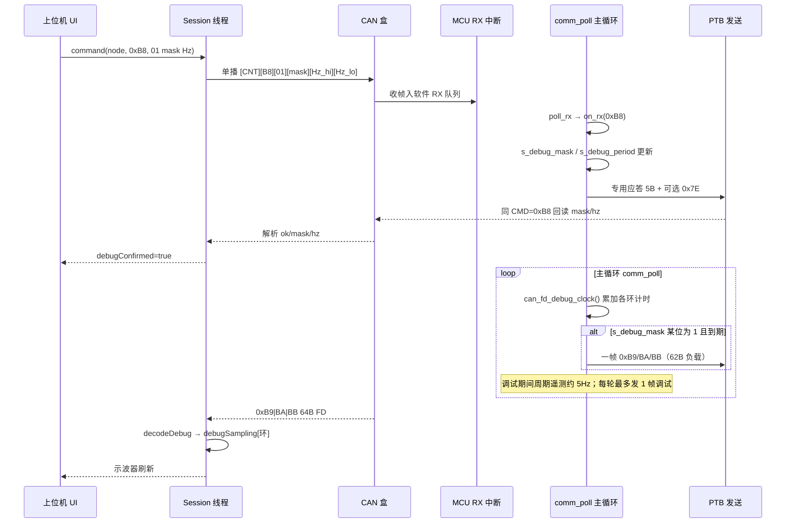

# 三环 PID 调试通信说明

协议字段与 CMD 定义见 **[CAN-FD扩展协议.md](CAN-FD扩展协议.md)**（`0xB8`–`0xBB`、`0x42`–`0x49` 等）。本文侧重上位机流程与示波器语义。

PID 调试在协议里分成三块，不要混用成功条件：

| **能力**         | **指令**                          | **方向** | **作用**                          |
| -------------- | ------------------------------- | ------ | ------------------------------- |
| **调试流订阅**      | `0xB8` 配置                       | 主机→设备  | 打开/关闭三环快照上报                     |
| **调试数据**       | `0xB9` / `0xBA` / `0xBB`        | 设备→主机  | 电流 / 速度 / 位置环 PID 内部量（被动推送）     |
| **PID 参数**     | `0x42`–`0x44` 写、`0x47`–`0x49` 读 | 请求-应答  | 改/查 Kp、Ki、Kd（与示波器独立）            |
| **周期遥测**       | `0x00`（CMD=0）                   | 设备→主机  | 默认 1 kHz；调试开启时降为 **5 Hz**       |
| **分发确认**       | `0x7E`                          | 设备→主机  | 仅表示 `0xB8` 等命令已进分发，**不等于**调试已生效 |
| **电流环辨识（FRA）** | `0xBC` / `0xBD` / `0xBE`        | 请求-应答  | CST 扫频，不是 `0xB8` 示波器            |

MotorTune 示波器在「PID 调试」档下走 `0xB8` **→ 被动收** `0xB9`**–**`0xBB`；改 PID 仍要先失能再发 `0x42`–`0x44`。

# 流程

固件侧要点（`can_fd_custom.c`）：

1. `0xB8` 必须单播（`s_request_unicast`）；广播直接忽略。
2. 请求负载（去掉 CNT/CMD 后）：`version=1`、`mask`（bit0 电流 / bit1 速度 / bit2 位置，仅允许 `0..7`）、`Hz` 大端 u16。
3. 校验：`mask≠0` 时 `1≤Hz≤1000`，且 `Hz × mask 中 1 的个数 ≤ 1000`（三环全开时每环最高约 333 Hz）。
4. 成功后 `s_debug_mask`、`s_debug_period = 1e6/Hz`；mask 或 Hz 变化时清零各环 elapsed。
5. 应答 5 字节：`01` + `error_t` + 当前 `mask` + 实际 `Hz`；单播还会跟 `0x7E`（回显请求 CNT/CMD）。
6. 不会在 `0xB8` 里立刻发调试帧；数据在后续 `can_fd_custom_poll()` → `can_fd_debug_poll()` 里按周期推送。
7. 调试开启时 `report_interval = 200 ms`（5 Hz），减轻 PTB 与 1 kHz 遥测争抢；IAP 活跃会 清零 `s_debug_mask`。

上位机侧要点（MotorTune `window.cpp` / `session.cpp`）：

- 仅 V2、已连接、非 IAP 升级时允许配置。
- 发 `0xB8` 后必须 专用应答里的 `mask`/`hz` 与请求一致 才置 `debugConfirmed`；不看 `0x7E` 作为“流已开”。
- 收到 `0xB9`–`0xBB` 且 DLC/62B 有效时，`decodeDebug` 写入 `debugSampling[0..2]`，用设备 `pid.timestamp` 重建时间轴（兼容 DWT→µs 的 2³²/180 回绕）。

停止：`mask=0` 的 `0xB8`（断开连接时也会发 `01000064` 一类停止帧）。

---

## `0xB8` **参数说明**

| **字段**      | **含义**                                                   |
| ----------- | -------------------------------------------------------- |
| `mask=0`    | 关闭调试流                                                    |
| `mask bit0` | 订阅 **电流环** → 设备发 `0xB9`                                  |
| `mask bit1` | 订阅 **速度环** → `0xBA`                                      |
| `mask bit2` | 订阅 **位置环** → `0xBB`                                      |
| `mask=7`    | 三环同时订阅；轮询 **round-robin**，每轮最多 **1 帧**，总带宽仍受 1000 帧/s 限制 |
| `Hz`        | **每个已订阅环**的目标帧率，不是三环合计                                   |

示例（单播 node=1，CNT 由主机递增）：

- 只订电流环 100 Hz：`… B8 01 01 00 64`
- 三环各 100 Hz：`… B8 01 07 00 64`（3×100≤1000）
- 停止：`… B8 01 00 00 64`（Hz 在 mask=0 时可忽略校验）

---

## **调试数据帧** `0xB9` **/** `0xBA` **/** `0xBB`

- **CAN-FD DLC=64**：`[CNT][CMD][62B DATA]`（尾部 CAN 填充）。
- **DATA 布局**（大端）：

| **偏移** | **内容**                                                                                          |
| ------ | ----------------------------------------------------------------------------------------------- |
| 0      | 版本 **`3`**（v2=`2`，v1=`1`）                                                                                          |
| 1      | **Flags**：bit0 环在本模式**正在执行**；bit1 配置了输出 ramp；bit2 故障；**bit3** 表示 `reference` 为**上层给定**（非级联内环输出） |
| 2–5    | `pid.timestamp`（设备 tick，µs 量级；上位机用于时间轴）                                                         |
| 6–49   | **11×float32**（v3；无 `shaft_velocity`，见扩展协议）                                             |
| 50–59  | **5×u16 BE**：电流/速度/位置环、`foc_control_run`、`foc_control_loop`（µs）                    |

**float 含义**（固件 `can_fd_debug_send`，环由 CMD 区分；v1 帧尾另含积分限幅、ramp 两个 float，详见扩展协议）：

| **序号** | **物理量**                      | **电流环**           | **速度环**                 | **位置环**                 |
| ------ | ---------------------------- | ----------------- | ----------------------- | ----------------------- |
| 0      | 上层给定                         | `ref.iq`          | `ref.speed_rad_s`       | `ref.position_rad`      |
| 1      | 环反馈                          | `iq_pid.feedback` | `velocity_pid.feedback` | `position_pid.feedback` |
| 2–3    | `Iq`, `Id`                   | 状态量               | 同左                      | 同左                      |
| 4–6    | `dt`, 积分状态, PID 输出           | 该环 PID            | 该环 PID                  | 该环 PID                  |
| 7–8    | 母线滤波值, 轴速度                   | 全局                | 全局                      | 全局                      |
| 9–11   | `Kp`, `Ki`, 输出限幅 | 该环配置              | 该环配置                    | 该环配置                    |

**“active”语义**：与当前 **控制模式** 和 **RUNNING** 一致时 bit0=1（例如速度环仅在速度/位置模式为 active）。未 active 时仍可能收到历史 PID 状态快照，上位机 UI 会标「环未执行」。

上位机 `protocol.cpp` 会把通道映射为示波器曲线（反馈、误差、Iq/Id、积分、输出、Kp/Ki 等）；**bit3=1 时不画 “Kp×误差” 为 P 项**（避免把上层给定误差误当控制器 P 项）。

---

## **PID 参数读写（调参，不是示波器）**

| **CMD**       | **名称**               | **失能要求** | **应答**                                    |
| ------------- | -------------------- | -------- | ----------------------------------------- |
| `0x42`        | SET 位置 PID           | **必须失能** | 成功则 `0x47` **同结构回读**                      |
| `0x43`        | SET 速度 PID           | 同上       | → `0x48`                                  |
| `0x44`        | SET 电流 PID           | 同上       | → `0x49`（Iq/Id 各 6B，共 12B 载荷里打包）          |
| `0x47`–`0x49` | GET 三环 PID           | 无        | 6B：`Kp,Ki,Kd` 各 u16 BE，**运行值 = raw/4096** |
| `0x4D`        | SAVE_PARAMS          | 失能       | 持久化                                       |
| `0x54`        | RESET_PID_TO_FACTORY | 失能       | 恢复 PID 默认值                                |

写 PID 会 `mc_clear_pid_state()` 清积分等运行时状态。

典型调参顺序：**失能 → GET/SET PID →（可选 SAVE）→ 设模式 → 使能 → 再开** `0xB8` **看波形**。

---

## **与周期遥测、ACK 的关系**

- `0x00` **周期上报**：位置/速度/电流/模式/故障等；调试时固件主动 **降到 5 Hz**，避免占满 PTB。
- `0x7E`：`0xB8` 单播后会发，只表示命令进过分发；**调试是否开启以** `0xB8` **专用应答的 mask/hz 为准**。
- 调试帧 **无请求-应答配对**，主机持续 `ReceiveFD` 即可；Session 对 `0xB9`–`0xBB` **不做 pending/ACK 匹配**。

---

## **相关：电流环辨识** `0xBC`**–**`0xBE`**（扫频，不是示波器）**

若做 **带宽/辨识**（MotorTune「数据分析 → 扫频」），走 FRA 扩展，与 `0xB8` 并行存在但互斥占用：

- `0xBC`：CST、已使能、**Iq 给定≈0**、无故障时启动；`action=0` 停止并失能。
- `0xBD`：只查状态（不续租、不产生新数据）。
- `0xBE`：完成后按 `run_id`+`index` 读频点 H1/相干度。

运行中收到 `0x03` **等电流给定** 会 `FRA_FLAG_CONFLICT` **中止**。细节见 `motor_controller_hmi/docs/DEVICE_FRA.md`。