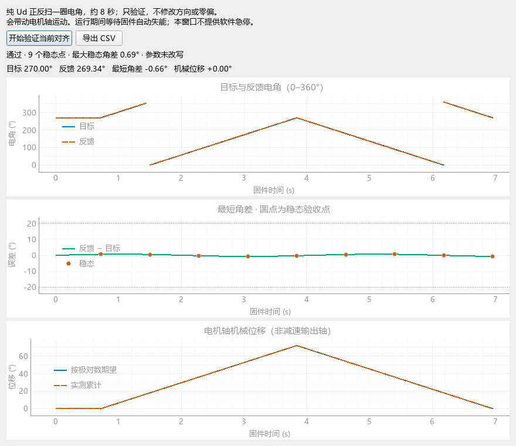
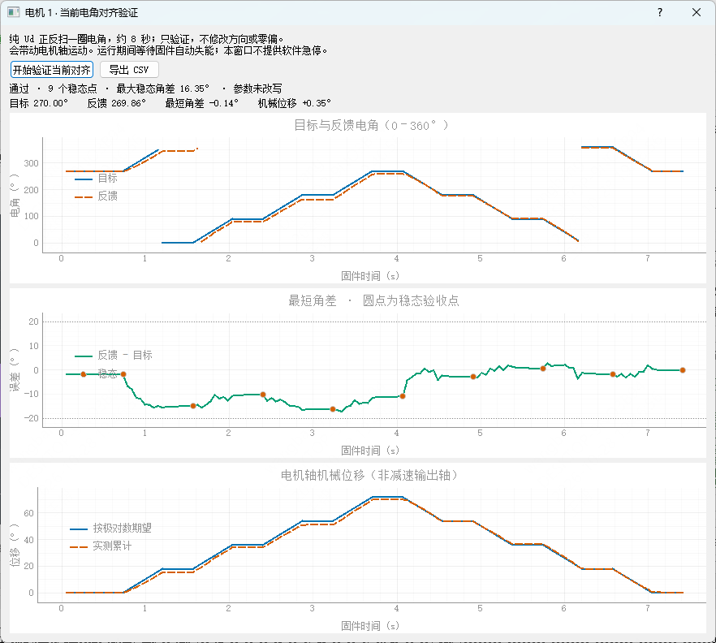

# 电角对齐实时验证

## 使用

重新编译并烧录固件，重启新版 GUI，通过 CAN-FD 连接电机。在校准页完成 Ud 对齐并失能后，点击“验证当前对齐 · 实时曲线”，再点击“开始验证当前对齐”。

验证使用当前 direction、pole_pairs 和电角零偏，不重算、不保存参数。可以验证当前 RAM 参数，也可以验证重启后加载的参数；不要求本次启动已执行过校准。

电机在纯 Ud 下先锁定 270°，然后缓慢移动到 0°、90°、180°、270°，再反向回到初始位置。一共检查 9 个锁定点。机械轴前进约 `360° / 极对数`，再返回。默认电压沿用 `ALIGN_ELECTRICAL_VOLTAGE_D_V`，运动和锁定约 12.3 秒，加上采样、总线开销，界面提示约 13 秒。

这是现有前台阻塞校准架构中的有限时长命令，过程中 GUI 保持绘图，但固件不处理新的普通控制命令；窗口没有软件急停按钮。界面避免在运行中关闭或再次启动，并在 25 秒没有完整结果时显示超时。超时不是电机已停止的确认。

## 看图判断



- 第一幅图：目标电角和反馈电角应随正反扫角基本重合。360° 与 0° 的跨越处断开连线，避免误画整幅竖线。
- 第二幅图：有符号最短角差，零附近代表准确。圆点是锁定等待结束后的验收样本；虚线为默认 ±0.35 rad（约 ±20.05°）参考线。动态误差保留显示，但只在锁定点做零偏判定。 

> **绿色曲线**是发送到 GUI 的误差采样；**橙色圆点**是每个锁定等待结束时的验收样本。当前验证流程有 9 个验收位置：
>
> ```
> 270° → 0° → 90° → 180° → 270°
>                          ↓
> 270° ← 0° ← 90° ← 180° ← 270°
> ```
>
> 更准确的按连续电角表示
>
> ```
> 270 → 360 → 450 → 540 → 630 → 540 → 450 → 360 → 270
> ```

- 第三幅图：电机轴累计机械位移与配置极对数计算的期望位移。不是减速输出轴。5 极对时正向终点应在约 72°，反向结束应回到约 0°。
- “通过”要求固件返回成功、会话一致、序号连续、样本总数与结束应答一致，并包含 9 个锁定点。断流、丢帧或旧会话结果不能判为通过。

固件对每个锁定点检查最短角差不超过 `ALIGN_ROTOR_ENGAGE_TOL_RAD`；累计机械位移误差不超过一个机械电周期位移的 15%。GUI 虚线使用默认值；如果修改固件编译期容差，需要同步调整 GUI 参考线，最终以固件判定为准。

可以导出 CSV，包括会话、序号、固件时间、阶段、锁定标志、目标/反馈/误差、实测/期望机械位移、结束错误码及数据完整性。角度字段均为度。失败或断流的数据也可以导出，文件会保留失败或不完整标记。

## 固件行为

入口 `cal_verify_electrical` 位于 `project/APP/FOC/foc_calibration.c`。要求电机处于 IDLE、驱动已失能、无锁存故障且电流零偏已校准；非法方向和零极对数会拒绝。

每 5 ms 施加电压、更新传感器并调用已有故障保护；约每 50 ms 主动发送曲线样本，每个锁定点额外发送验收样本。时间由板载微秒计数器按低 16 位增量累计，以处理硬件计数回绕。机械位移按相邻机械角最短差累计，并在初始锁定结束建立零位。

检测到硬件故障、驱动退出或发送失败时终止。结束和失败路径均失能并清除电流 PID。验证不改变方向、极对数、零偏和对齐成功标志；误差不合格返回 ERR_ALIGIN_FAILED，不用一次检查覆盖原校准参数。

## CAN-FD 扩展

既有 0xAB 对齐命令及应答保持不变。新命令仅接受目标节点单播，广播验证被丢弃，防止多个轴一起运动。

所有多字节字段为大端。协议帧仍为 CNT、CMD、payload，再按 CAN-FD DLC 填零。

### 0xB1 请求

3 字节 payload：版本 `1`（u8）与 GUI 生成的会话号（u16）。旧固件不认识该命令时，GUI 显示超时而不是通过。

### 0xB2 曲线样本

| payload 偏移 | 类型 | 含义 |
|---|---|---|
| 0 | u8 | 版本 1 |
| 1 | u8 | 阶段：0 初始锁定、1 正扫、2 反扫 |
| 2 | u8 | bit0：锁定末验收点 |
| 3 | u8 | 保留 |
| 4 | u16 | 会话号 |
| 6 | u16 | 本次序号，从 0 开始 |
| 8 | u32 | 已经过的毫秒数 |
| 12 | i32 | 目标电角，微弧度 |
| 16 | i32 | 反馈电角，微弧度 |
| 20 | i32 | 最短角差，微弧度 |
| 24 | i32 | 累计机械位移，微弧度 |
| 28 | i32 | 期望机械位移，微弧度 |

有效 payload 为 32 字节，加 CNT/CMD 后填充为 48 字节 CAN-FD 帧。

### 0xB1 结束应答

12 字节 payload：版本 u8、error_t u8、会话号 u16、成功提交发送的样本数 u16、保留 u16、最大已测锁定点角差 i32（微弧度）。加帧头后填充为 16 字节。

若前置条件拒绝或在早期退出，最大误差只代表已采到的锁定点，甚至为零，不表示通过。结果码及完整性是首要判断。

## 验证与限制

- 固件模拟回归执行实际校准/验证代码：已有 16 组方向与极对数组合，以及新验证的 9 个锁定点、错误零偏、错误方向、错误极对数、计时回绕、通讯失败、硬件故障和使能/电流零偏前置检查。
- GUI 完整测试集 18 项通过，包括新协议的填充/有符号解析、丢帧、旧会话、非锁定数据、超时、发送失败和窗口连接。
- 现有 Keil 配置完整编译并链接 58 个目标文件；保留工程原有警告。
- 离屏渲染检查了中文、图例和三幅图的布局；预览数据为模拟数据。

# 结果分析



这次验证完整通过，方向和极对数关系基本正确，回位也准确；但正向存在明显滞后，尚不能称为高精度对齐。

| 观察项 | 截图结果 | 判断 |
| ------ | ------ | ------ |
| 流程完整性 | 约 7.5 秒、9 个稳态点、显示通过 | 本次已正常完成，之前的超时现象没有出现 |
| 最终回位 | 目标 270°，反馈 269.86°，误差 −0.14° | 最终电角回位准确 |
| 机械位移 | 正向约 72°，随后返回零附近 | 与 5 极对的配置相符 |
| 最大稳态角差 | 16.35°电角 | 小于当前约 20.05°的门限，但余量不大 |
| 正反一致性 | 正扫误差约 −10°～−16°；反扫多数接近 0° | 存在方向相关的跟随误差 |

最值得关注的是中间的误差曲线：

- 正扫阶段约 0.8～4 秒：反馈持续落后目标，停在锁定点后仍保留较大误差，说明不只是运动中的瞬时延迟。
- 反扫阶段约 4～7.5 秒：误差明显缩小，最后回到 −0.14°。
- 相同目标角在不同运动方向下，误差不同。这更像摩擦、负载或机械回差与锁定力共同造成的现象，不能仅凭截图确定原因。单纯增加一个固定零偏，通常不能同时改善两个方向。
另外，顶部“机械位移 +0.35°”与第三幅图末端接近零并不矛盾。机械位移是相对初始机械位置累计的量，−0.14°则是最终反馈电角相对目标的误差，两者基准不同。

建议下一步按顺序验证：

1. 保持参数不变，重复运行几次，确认正向滞后是否稳定复现。
2. 将锁定等待时间从 350 ms 延长到约 1 秒。若稳态误差明显缩小，说明原先等待不足；若仍保持，重点检查静摩擦、负载和锁定力。
3. 在允许的条件下减小机械负载，再比较正反曲线。调整 Ud 电压前先观察相电流和温升，不宜直接靠加大电压消除误差。

当前结果支持继续做低电流闭环测试，但“验证通过”只代表满足现有较宽的门限，并不等于电流采样极性、PI 参数和带载性能都已验证。