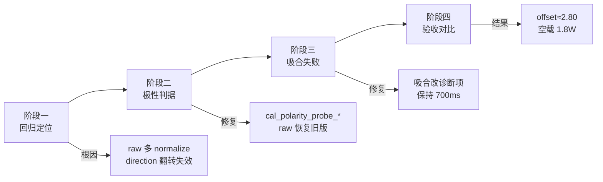
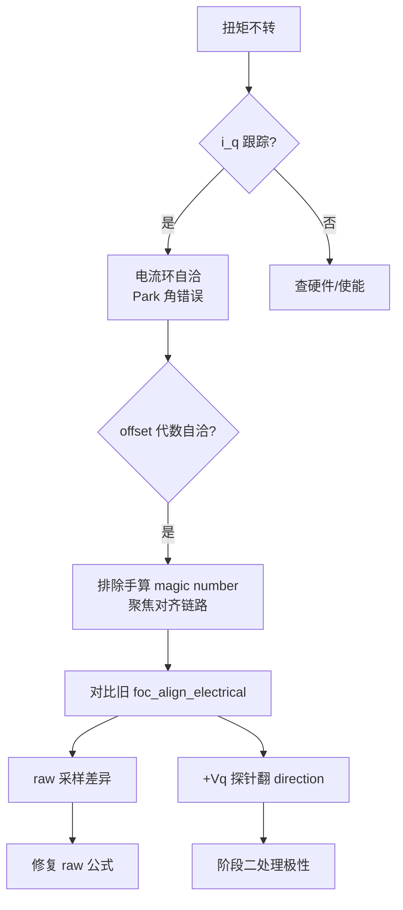
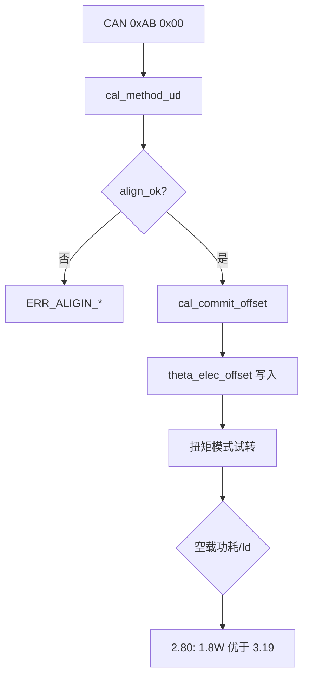
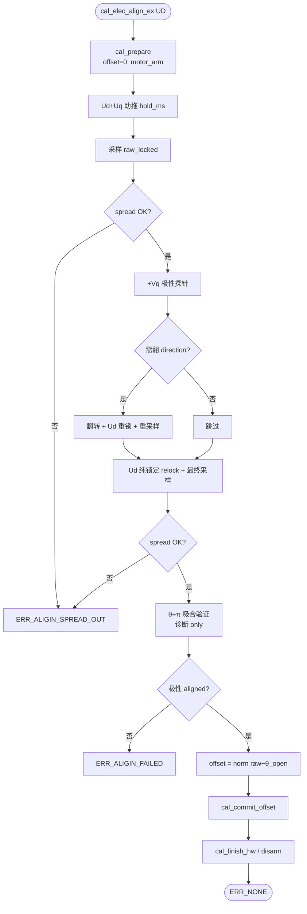

# FOC Ud 电角对齐 — 四次排查与修复记录

> 项目：`motor_controller/project`（AT32M416 + MP6540 + KTH71）  
> 方法：`CAL_ELEC_ALIGN_UD`（CAN `0xAB 0x00`）  
> 日期：2026-03-22

---

## 1. 背景与目标

将原 `foc.c` 内 `foc_align_electrical()` 迁入 `foc_calibration.c` 后，出现：

| 现象 | 整合前 | 整合后（失败） |
|------|--------|----------------|
| `theta_elec_offset_rad` | ≈ 5.67（可转） | ≈ 0.26~0.41（不转） |
| 扭矩模式 | 正常 | `i_q` 能跟踪，`i_d≈0`，电机不转 |
| 手动 offset `3.193` | — | 可转但非最优 |

**Ud 对齐唯一不变量**（锁定瞬间）：

```
θ_open = _3PI_2 = 4.712 rad
raw_locked = shaft.angle_rad × pole_pairs        // 未减 offset
offset     = normalize(raw_locked − θ_open)
theta_elec = normalize(raw_locked − offset) = θ_open
```

运行时与 `encoder.c` 一致：

```c
theta_elec_rad = angle_normalize(shaft.angle_rad * pole_pairs - theta_elec_offset_rad);
```

---

## 2. 四次分析处理总览



| 阶段 | 触发 | 核心结论 | 代码动作 |
|------|------|----------|----------|
| **一** | offset≈0.41，扭矩不转 | 问题在电角对齐，非 direction 手算 | 恢复 `raw=angle×pp`；梳理极性链 |
| **二** | 极性修正后 offset 仍错 | `POLARITY=-1` 使旧 `iq<0` 翻方向逻辑失效 | `cal_polarity_probe_needs_flip/aligned` |
| **三** | `error_t=11` 吸合失败 | 转子未 π 步进；offset 不依赖吸合 | 吸合非阻断；`hold_ms` 用于反相点 |
| **四** | 对齐成功 | 自动 2.80 优于手动 3.19 | 空载 1.8W vs 1.9W，堵转瞬态更低 |

---

## 3. 阶段一：整合回归定位

### 3.1 现象

- `align_raw_elec_rad ≈ 5.125` → `offset ≈ 0.41`（代数自洽）
- `align_theta_after ≈ 1.51`：在 **θ+π 吸合验证之后**读取，≈1.57 为**正常**，不能用作失败判据
- 扭矩模式 `theta_elec` 与 offset 计算链自洽，但物理上不产生转矩 → **零位与磁场不匹配**

### 3.2 根因（两项）

1. **`cal_encoder_raw_elec_rad` 多做了 `angle_normalize`**  
   旧版 `foc_align_raw_elec_rad` 仅为 `angle_rad × pole_pairs`。

2. **`CURRENT_SENSE_PHASE_POLARITY = -1` 后 direction 翻转失效**  
   旧判据 `iq_probe < 0` 在极性修正后不再触发翻转，或误翻转，导致 `direction` 与 offset 采样不一致。

### 3.3 分析流程



### 3.4 实测对照（阶段一）

| 变量 | 失败案例 | 说明 |
|------|----------|------|
| `align_raw_elec_rad` | 5.125 | 锁定采样 |
| `theta_elec_offset_rad` | 0.413 | `normalize(5.125−4.712)` |
| `align_direction_flipped` | 1 | 旧 `iq<0` 曾触发翻转 |

---

## 4. 阶段二：极性探针与 direction 翻转

### 4.1 物理关系

相电流在 `current_sense.c` 已乘 `CURRENT_SENSE_PHASE_POLARITY`。对齐探针读的是 **修正后** `state.i_q`，判据应补偿极性：

| `CURRENT_SENSE_PHASE_POLARITY` | 方向**正确**时 +Vq 探针 `i_q` | 应翻转? |
|-------------------------------|------------------------------|---------|
| +1 | > 0 | `iq < 0` 时翻 |
| **−1（本项目）** | **< 0** | **`iq > 0` 时翻** |

### 4.2 判据代码（最终版）

```c
static bool cal_polarity_probe_needs_flip(float iq_probe, float iq_min_a)
{
  if (fabsf(iq_probe) < iq_min_a) return false;
  if (CURRENT_SENSE_PHASE_POLARITY < 0.0f) return (iq_probe > 0.0f);
  return (iq_probe < 0.0f);
}

static bool cal_polarity_probe_aligned(float iq_probe, float iq_min_a)
{
  if (fabsf(iq_probe) < iq_min_a) return true;
  if (CURRENT_SENSE_PHASE_POLARITY < 0.0f) return (iq_probe < 0.0f);
  return (iq_probe > 0.0f);
}
```

### 4.3 极性探针流程

```mermaid
flowchart TD
  S[Ud+Uq 助拖锁定] --> T[采样 raw_locked]
  T --> P[+Vq 探针读 iq_probe]
  P --> Q{|iq| ≥ 阈值?}
  Q -->|否| R[不翻转]
  Q -->|是| U{极性判据<br/>需翻转?}
  U -->|是| V[cal_flip_direction]
  V --> W[Ud 纯锁定重采样]
  W --> X[再次 +Vq 探针]
  U -->|否| R
  R --> Y[Ud 纯锁定最终采样]
  X --> Y
```

---

## 5. 阶段三：吸合验证失败（error_t = 11）

### 5.1 现象

```
CAN: CMD=0xAB method=0x00 → 回复 0x0B (ERR_ALIGIN_ROTOR_NOT_ENGAGED)
```

| 变量 | 值 |
|------|-----|
| `align_raw_elec_rad` | 7.511 |
| `align_raw_engage_rad` | 7.548 |
| 位移 `normalize(Δraw)` | **0.037 rad**（需 ≥ π−0.35 ≈ 2.79） |

转子几乎未跟随 **θ+π** 开环电压步进（可能受 `sw_ocp=1.5A` 限流影响）。

### 5.2 关键结论

**offset 仅由 θ_open 锁定采样决定，不依赖吸合验证。**

吸合为诊断项；失败不应使 `theta_elec_offset_rad` 保持 0。

### 5.3 吸合验证流程

```mermaid
flowchart TD
  A[θ_open 最终锁定<br/>raw_locked] --> B[开环 θ+π<br/>Ud, Uq=0]
  B --> C[采样 raw_engage]
  C --> D{Δ = |norm raw_e − raw_l|}
  D --> E{Δ ≥ π − tol?}
  E -->|是| F[align_engaged=1]
  E -->|否| G[align_engaged=0<br/>诊断 only]
  F --> H[继续极性/写 offset]
  G --> H
```

### 5.4 本阶段修复

1. 吸合保持时间：`relock_ms(200)` → `hold_ms(700)`
2. **取消吸合失败阻断** Ud 对齐
3. 位移公式恢复：`fabsf(angle_normalize(raw_engage - raw_locked))`

---

## 6. 阶段四：验收与手动值对比

### 6.1 成功实测

| 变量 | 值 |
|------|-----|
| `align_raw_elec_rad` | 7.512 |
| `theta_elec_offset_rad` | **2.800** |
| `align_theta_after_rad` | 4.747 ≈ θ_open |
| `align_ok` / `electrical_align_done` | 1 |
| `align_engaged` | 0（诊断，可接受） |
| `fault` | `FAULT_NONE` |

验算：`normalize(7.512 − 4.712) = 2.800` ✓

### 6.2 与手动 offset 3.193 对比

| 指标 | 自动 offset **2.80** | 手动 offset **3.19** |
|------|------------------------|----------------------|
| 锁定点电角误差 | **≈ 0**（定义保证） | ≈ 0.38 rad |
| 空载功耗 | **≈ 1.8 W** | ≈ 1.9 W |
| 堵转瞬态 | 更低 | 更高 |
| `Id` 泄漏 | 更小 | 偏大（波形可见） |

手动 3.19 为历史手调值，未对应当前硬件链（相序、电流极性、编码器方向）下的 Ud 锁定公式。

### 6.3 验收流程



---

## 7. 最终 Ud 对齐完整流程



---

## 8. 相关文件

| 文件 | 说明 |
|------|------|
| `APP/FOC/foc_calibration.c` | Ud 对齐主逻辑 |
| `APP/FOC/encoder.c` | `theta_elec` 运行时计算 |
| `APP/FOC/current_sense.h` | `CURRENT_SENSE_PHASE_POLARITY` |
| `APP/common.h` | `ALIGN_*` 参数 |
| `tools/align_simulation.py` | 数值仿真与绘图 |

---

## 9. 仿真复现

```bash
cd motor_controller
pip install numpy matplotlib   # 可选
python tools/align_simulation.py
```

生成：

- `docs/align_simulation_offset.png` — offset 2.80 vs 3.19 锁定误差与整圈轨迹
- `docs/align_simulation_engage.png` — 吸合 π 步进理想 vs 实测

---

## 10. 遗留与建议

1. **`align_engaged=0`**：空载/小电流时转子可能无法完成 π 步进，不影响 offset 正确性；若需严格吸合，可提高反相点 `Ud` 或放宽 `ALIGN_ROTOR_ENGAGE_TOL_RAD`。
2. **`mc_interface.c` 硬编码 `3.19311523f`**：建议删除，改为依赖对齐或 Flash 参数。
3. **默认对齐方法**：CAN 无 method 字节时默认 `CAL_ELEC_ALIGN_UQ`；产线应显式发 `0x00`（UD）。

---

## 附录 A：错误码

| 值 | 宏 | 含义 |
|----|-----|------|
| 10 | `ERR_ALIGIN_SPREAD_OUT` | 采样分散度过大 |
| 11 | `ERR_ALIGIN_ROTOR_NOT_ENGAGED` | 吸合验证未通过（Ud 已不再阻断） |
| 12 | `ERR_ALIGIN_FAILED` | 极性/流程失败 |

---

## 附录 B：关键公式（Python 参考）

见 `motor_controller/tools/align_simulation.py`。
